# 智能体平台演示文档

Temporal 持久编排 + LangGraph 执行内核 + warrant 去中心化授权 + 双线审批（自主/管理员）+ 代码沙箱（配额与计量）。

## 智能体演示平台架构图

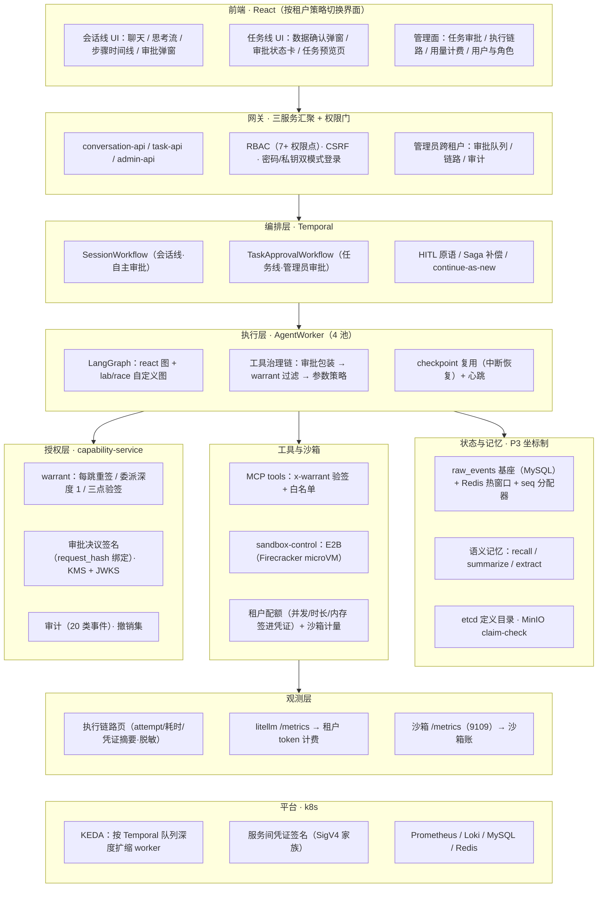

## 智能体演示平台说明

平台通过两个任务进行能力展示：

1.算法可视化：输入算法名称和数据，系统生成可视化步骤（只支持三种数据结构：线性结构，图，树。）

2.排序大乱斗：输入数组，执行预设的五个排序算法对比性能，并生成表格与可视化步骤

平台目的在于展示 ： 任务中断，任务恢复，审批，租户权限，Agent协作与治理，观测计量  

可通过默认卡片快速开始。演示入口https://web.taild04b47.ts.net/console/

登录后页面如下。如果无法访问，可在面试时现场演示。

## 演示账号

| 账号    | 密码     | 角色                   |
| ------- | -------- | ---------------------- |
| admin   | admin123 | 管理员（t-dev）        |
| alice   | alice123 | 一级租户普通用户       |
| vizuser | viz12345 | 二级租户（任务审批线） |

admin：管理员：对话（算法可视化，排序大乱斗），查看Agent目录，计费用量，执行链路，审批任务

alice：一级租户：对话（算法可视化，排序大乱斗），自主审批使用代码沙箱

vizuser：二级租户：对话（算法可视化），管理员审批使用代码沙箱（对应企业中任务关键节点审批），

​                                   预览任务进度。

## 演示截图（可跟随截图步骤操作）

### alice（一级租户）登录后自主审批使用代码沙箱。

| 沙箱执行弹出自助审批 | 审批通过后运行结果 |
|---|---|
| 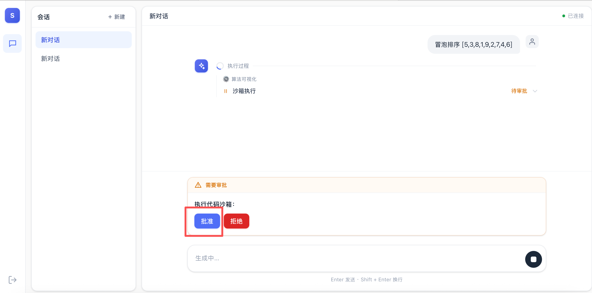 | 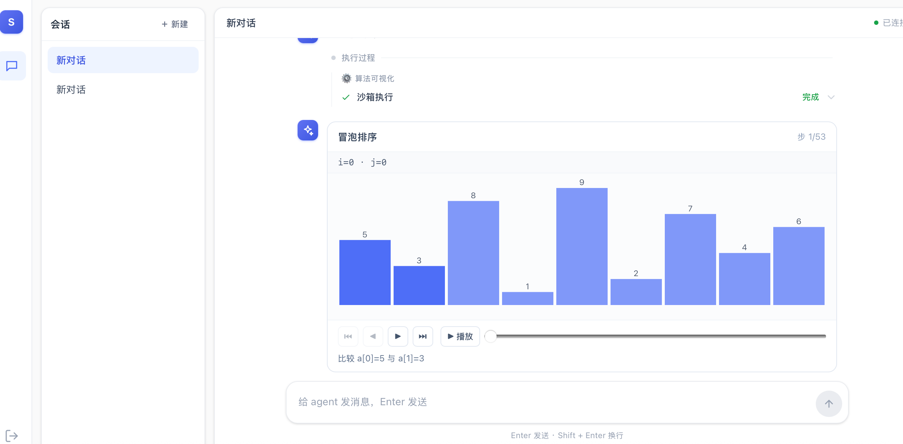 |

### 中断与恢复

| 生成中点「停止」 | 中断后界面（继续入口） |
|---|---|
| 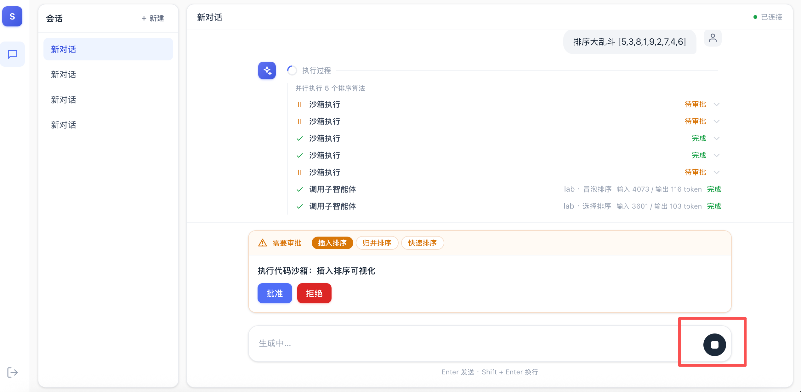 | 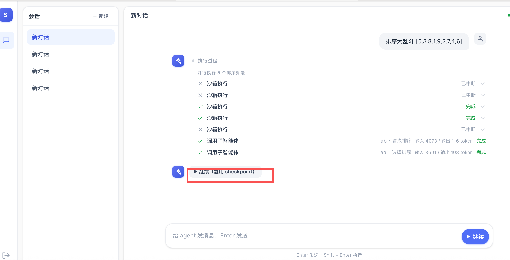 |

| 点「继续」恢复执行 | 恢复后执行结果 |
|---|---|
| 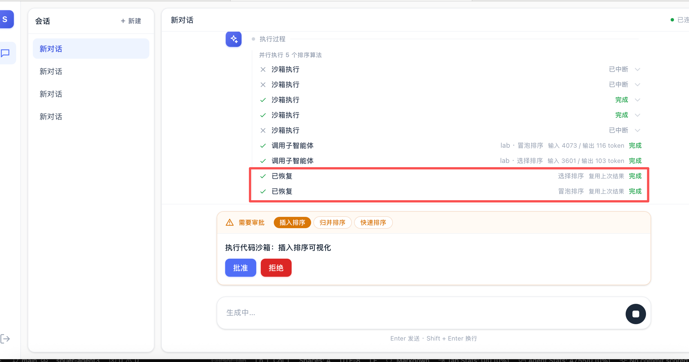 | 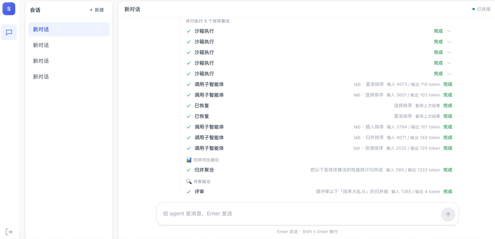 |

> 恢复 = LangGraph checkpoint 续跑：图态与审批位置原样续接；Temporal workflow 在 interrupt 处暂停，resume 信号精确唤醒。

### vizuser（二级租户）登录后使用代码沙箱需要管理员审批

| 系统状态卡：已提交管理员审批 | 任务预览页：进度  / 结果 |
|---|---|
| 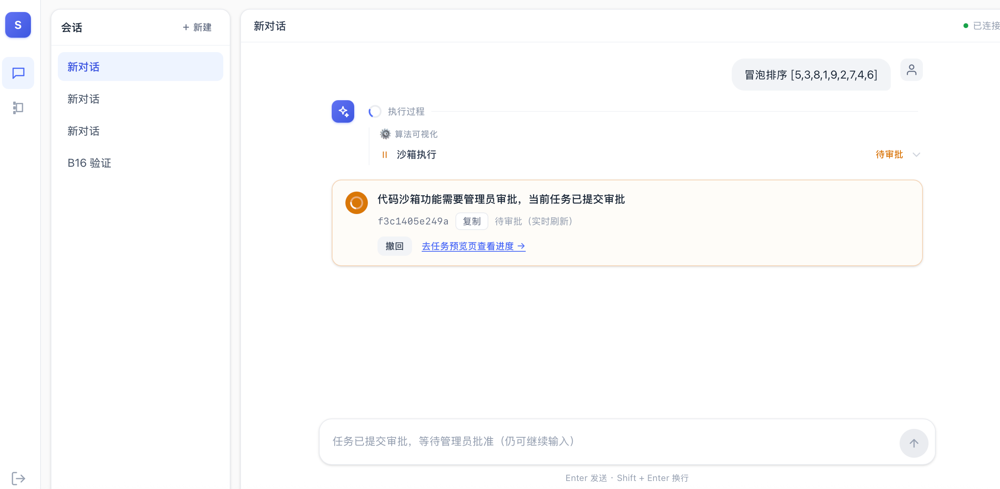 | 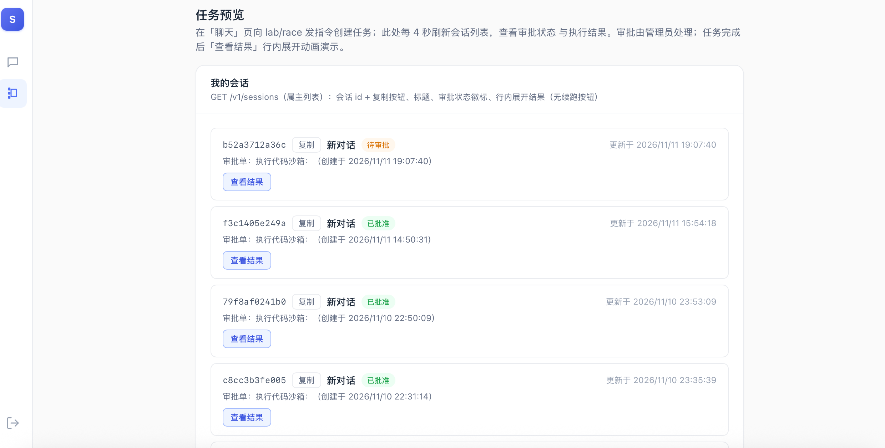 |

| 切换admin管理员账号审批任务 | 任务预览页：查看结果 |
|---|---|
| 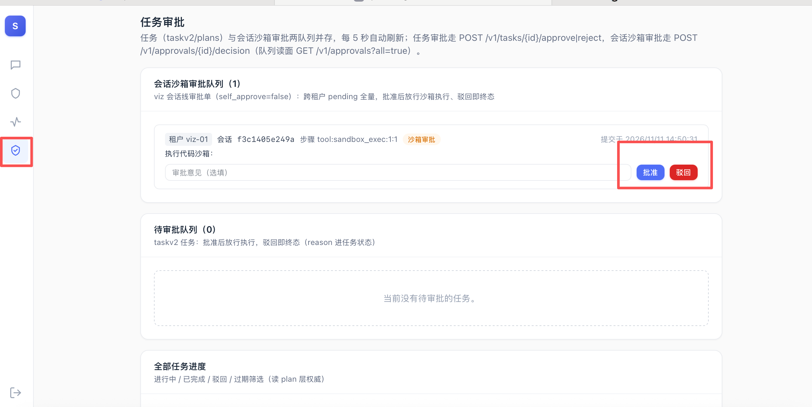 | 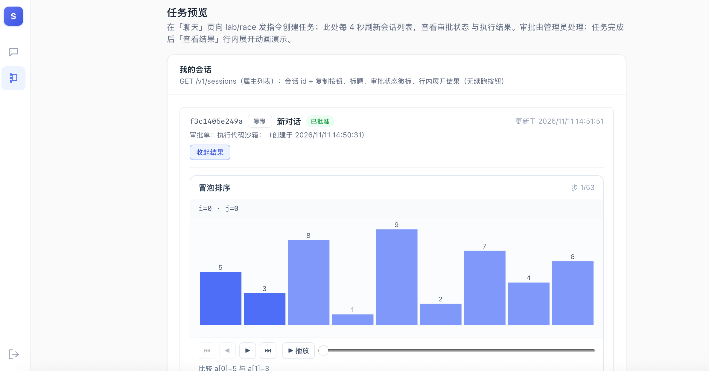 |

### 管理员视角

| 任务审批看板 | 批准 / 驳回操作 |
|---|---|
| 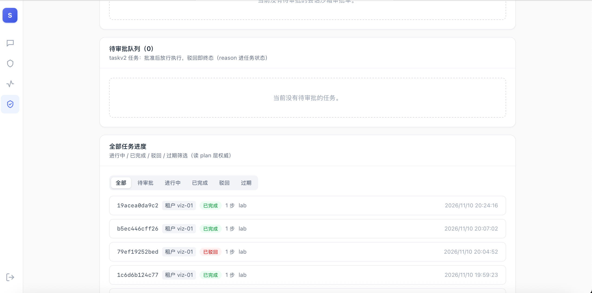 |  |

| 执行链路（route/agent/审批/llm/沙箱） | 智能体授权凭证展示（脱敏摘要） |
|---|---|
| 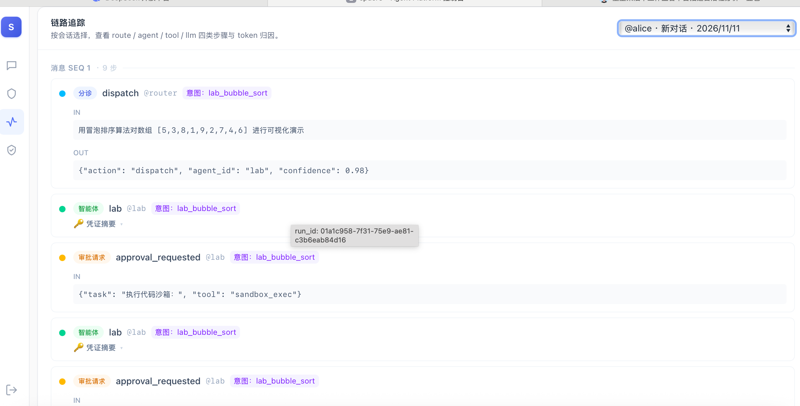 | 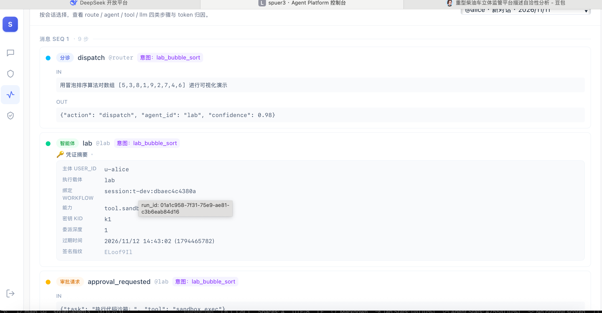 |

| agent 定义目录（版本化）可看到运行时所属执行池 | 租户用量计费 |
|---|---|
| 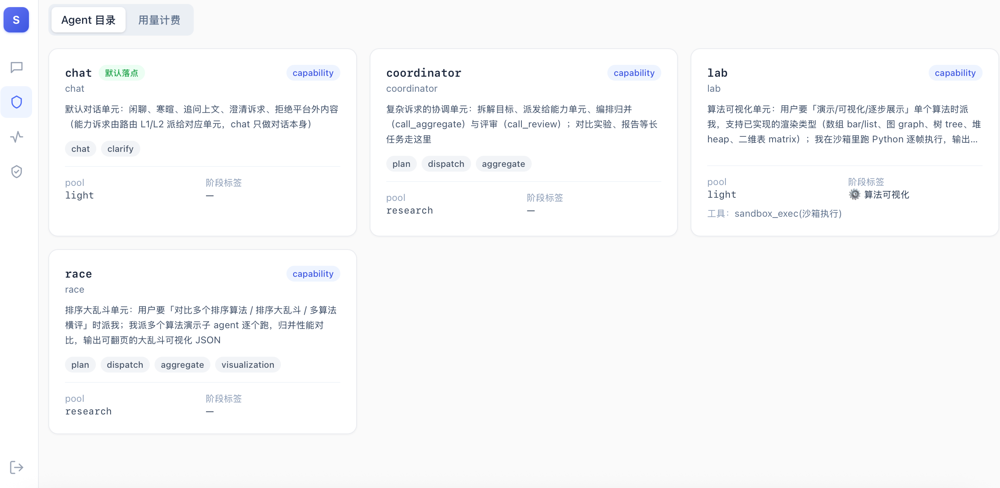 | 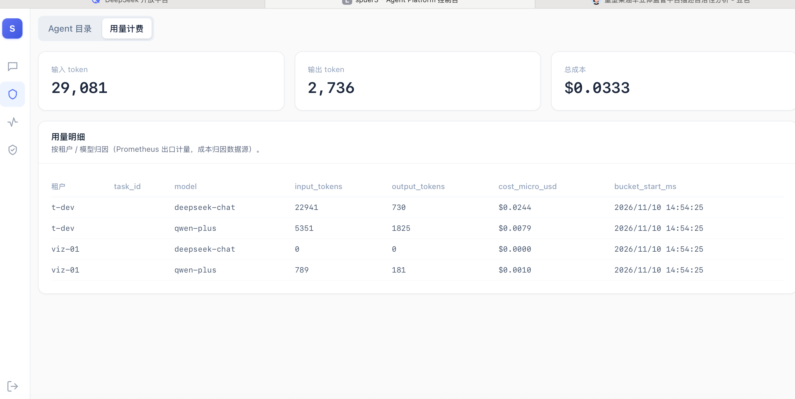 |

